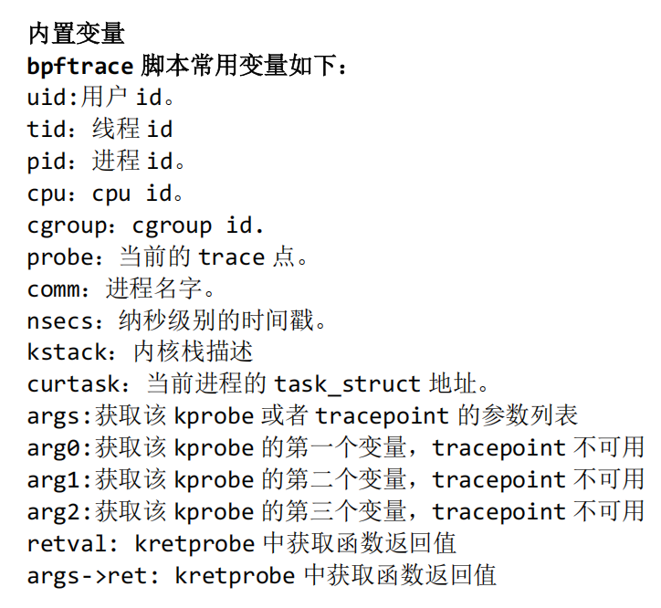
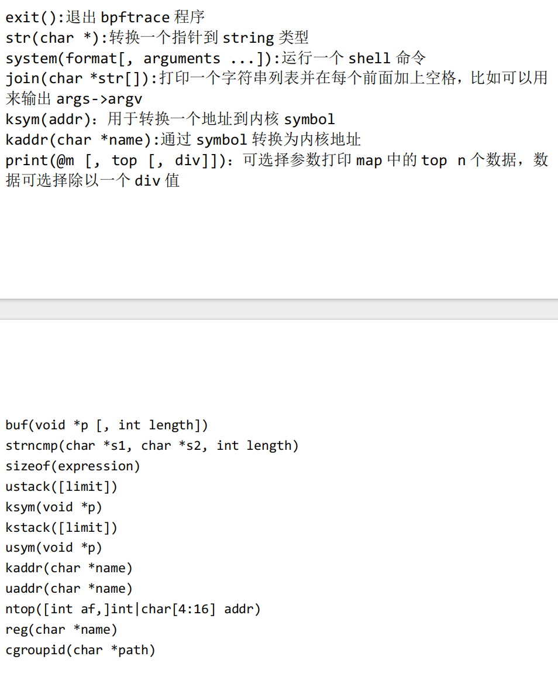
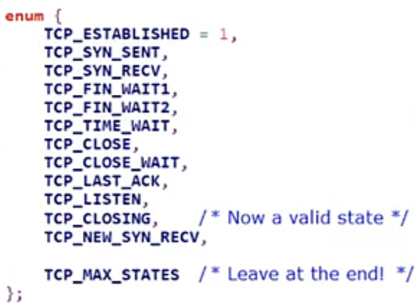

重点写清楚：探针挂在哪、为什么这么写、哪里容易翻车。覆盖三块实战：TCP 五元组、accept、连接寿命。

---

## 1. 环境与安装

内核建议 **≥ 5.10**。太老的内核要么缺 BTF，要么很多 tracepoint / 结构体字段对不上，脚本写起来会反复踩坑。

Debian / Ubuntu 上安装很直接：

```bash
sudo apt-get install bpftrace
```

装好后先确认 bpftrace 能看见系统上的探针挂载点：

```bash
bpftrace -l | head
```

`bpftrace -l` 会列出当前内核暴露出来的 probe（tracepoint、kprobe 能挂的函数名等）。如果这里几乎是空的，或者大量报权限 / BTF 相关错误，先别急着写脚本——环境没就绪，后面全是噪音。

常用检查：

```bash
bpftrace -l 'tracepoint:syscalls:sys_enter_accept'
bpftrace -l 'kprobe:tcp_connect'
uname -r
```

能列出对应行，说明这条路径至少挂得上。

---

## 2. 能干什么

bpftrace 本质上是：**在内核 / 用户态的特定挂点上插桩，读参数和返回值，做聚合或打印**，业务代码一行都不用改。

和以前自己排查问题的方式对比一下：

| 以前 | 现在 |
|------|------|
| 在业务里打时间戳，前后相减 | 在内核路径上直接记 `nsecs` |
| 只能看自己进程 | 可以全系统捕获，再按 `comm` / pid 过滤 |
| 改代码、发版、再复现 | 线上临时挂上脚本就能看 |

几个典型问题：

1. **TCP 连接寿命**：从 SYN_SENT / SYN_RECV 到 TCP_CLOSE，这条连接活了多久。
2. **MySQL SQL 耗时**：挂 MySQL 用户态函数（uprobe），看某条查询进到出花了多久。
3. **Redis 命令耗时**：同理，挂命令处理入口 / 出口。
4. **文件读写耗时**：挂 VFS 层 `vfs_read` / `vfs_write`，或 syscall 层 `read` / `write`。

有个容易忽略的点：**文件 write 返回成功，不等于数据已经落盘**。`write` 常常只是进了 page cache；真正刷盘要看 `fsync` / 提交 bio / block 层。所以「写文件慢」和「落盘慢」不是同一个探针能一次说清的问题——挂点选错，结论会偏。

bpftrace 的价值就在这里：你不用为了看一眼延迟去改业务、加日志、再发版。

---

## 3. Hello World

最短可运行的例子：

```bash
sudo bpftrace -e 'BEGIN { printf("hello\n"); }'
```

拆开看：

- **`-e`**：后面直接跟一段 bpftrace 程序，不用写成 `.bt` 文件。
- **外层单引号**：保护整段脚本不被 shell 展开。`$`、`*`、`{}` 在 shell 里都有特殊含义，双引号很容易踩坑；习惯上 `-e` 用单引号包住。
- **`BEGIN`**：脚本加载成功后立刻触发一次的特殊探针，适合打印表头、初始化。
- **`printf("hello\n")`**：和 C 的 `printf` 类似，**要自己写 `\n`**。忘了换行，输出会糊成一行，Ctrl-C 结束时才一起吐出来，看起来像「没反应」。

语法骨架就是 awk 那一套：

```text
probe / condition / { action }
```

`probe` 决定挂哪里，`/ condition /` 可选过滤，`{ action }` 里写读变量、算 map、打印。后面所有例子都是这个模式的变体。

跑起来会打印一行 `hello`，然后挂着等事件；`BEGIN` 只触发一次，没有别的 probe 时就安静等着，Ctrl-C 退出。

---

## 4. accept 探针：从「能列出」到「能过滤」

先别急着写动作，先确认挂点存在：

```bash
bpftrace -l '*accept*'
```

里面会看到一类很稳的挂点：

```text
tracepoint:syscalls:sys_enter_accept
```

`tracepoint` 是内核主动暴露的稳定观测点；syscall 进出都有对应的 `sys_enter_*` / `sys_exit_*`。对 `accept` 来说，进系统调用时用 `sys_enter_accept` 就够入门。

全系统抓一下（需要 root）：

```bash
sudo bpftrace -e 'tracepoint:syscalls:sys_enter_accept { printf("accept by %s pid=%d\n", comm, pid); }'
```

另开一个终端：起一个会 `accept` 的服务（比如本机 nginx），再用 `curl` 打一下。你会看到输出里蹦出真正在听连接的那个进程名——**全系统捕获**，谁走到了 `accept` 都会进来。

内置变量 **`comm`** 是当前任务的短进程名（通常截断到约 15 字符）。只想看自己的程序时，加过滤：

```bash
sudo bpftrace -e 'tracepoint:syscalls:sys_enter_accept / comm == "networkio" / { printf("accept by %s\n", comm); }'
```

注意三点：

1. 过滤写在 **`/ ... /`** 里，不是 `if` 包住整个 probe（probe 级过滤更干净，不匹配的事件更早丢掉）。
2. 字符串比较用 `==`，进程名要和 `/proc/<pid>/comm` 对得上；名字被截断时，过滤器也要写截断后的名字。
3. 固定模式再次出现：**`probe / condition / { action }`**。

`tracepoint` 可以缩写成 **`tp`**：

```bash
sudo bpftrace -e 'tp:syscalls:sys_enter_accept / comm == "networkio" / { printf("hit\n"); }'
```

入门阶段优先用 tracepoint：ABI 相对稳定，比直接 kprobe 内核内部函数少跟版本打架。

---

## 5. 内置变量与函数

bpftrace 提供一批开箱即用的变量和函数。自己写脚本时最常用的就是 `pid` / `tid` / `comm` / `nsecs` / `arg0`…、以及 `printf` / `time` / `ntop` / `bswap` / map 操作。完整清单以你环境里的手册为准，下面两张图是当时整理的速查：





实战里高频的几个：

- **`pid` / `tid` / `comm`**：谁触发了这次探针。
- **`nsecs`**：单调纳秒时间戳，算耗时用它，不要用墙上时钟相减糊弄。
- **`arg0`, `arg1`, ...**：kprobe / uprobe 的参数；kretprobe 用 **`retval`**。
- **`printf` / `time`**：打印；`time()` 格式串后面**语句要分号**（见实战一）。
- **`ntop()`**：把内核里的地址字段打成可读 IP。
- **`bswap()`**：网络字节序端口翻转。
- **`@map[key]`**：全局 map，跨事件存状态；`$var` 只在当前 action 内有效。

---

## 6. 探针类型：红绿灯比喻

可以把探针想成路口的灯——都能让你「停下来看一眼」，但稳定性和能看见的东西不一样。

| 类型 | 比喻 | 含义 | 注意 |
|------|------|------|------|
| **tracepoint** | 绿灯 | 内核标好的稳定观测点 | 优先用；字段相对稳定 |
| **kprobe** | 黄灯 | 动态挂内核函数入口 | 函数名 / 参数随内核变；能看到内部路径 |
| **kretprobe** | 黄灯（出口） | 挂内核函数返回 | 用 `retval`；要返回值时必须用它 |
| **uprobe** | 红灯偏多 | 挂用户态二进制 / 库函数 | 依赖符号、地址、版本；最灵活也最脆 |

「connect」这件事，挂点可以差很多层：

- **VFS / syscall 层**：`connect` 系统调用入口——所有协议族都可能经过。
- **TCP 层**：`tcp_connect` / `tcp_v4_connect`——已经确认是 TCP 路径。
- **UDP**：另有 `udp_sendmsg` 等，和 TCP 的 connect 语义不同。

同一句「我想看连接」，挂错层会看到完全不同的事件集合。TCP 客户端发起连接，入门实战挂 **`kprobe:tcp_connect`** 通常比只挂 syscall 更贴「TCP 五元组」这个目标。

---

## 7. 实战一：`tcp_connect` 打五元组

目标：每次有进程走 TCP `connect` 路径时，打印时间、进程、源/目的 IP 和端口。

### 7.1 不要乱 `#include`

有的旧教程会写：

```c
#include <linux/socket.h>
#include <net/sock.h>
```

在 **BTF 已经可用** 的现代发行版上，bpftrace 往往能直接认识 `struct sock` 等类型。再强行 include 一堆内核头，反而容易：

- 头文件路径 / 版本和运行内核不一致；
- 宏和类型冲突；
- 脚本直接编译失败，报一长串难以定位的错误。

所以下面的脚本：**不要** `#include linux/socket.h` 和 `net/sock.h`。需要的常量自己写死 ABI 值即可（`AF_INET` 在 Linux 上是 `2`，这是稳定 ABI）。

### 7.2 可跑脚本

把下面存成 `tcp_connect_tuple.bt`，或用 `-e` 整段贴进去：

```bash
sudo bpftrace -e '
BEGIN
{
    printf("%-10s %-8s %-16s %-15s %-6s %-15s %-6s\n",
           "TIME", "PID", "COMM", "SADDR", "SPORT", "DADDR", "DPORT");
}

kprobe:tcp_connect
{
    $sk = (struct sock *)arg0;
    $family = $sk->__sk_common.skc_family;

    // 非 IPv4 直接跳过；字段布局不同，硬读会得到垃圾
    if ($family != 2) { // AF_INET
        return;
    }

    $saddr = ntop(2, $sk->__sk_common.skc_rcv_saddr);
    $daddr = ntop(2, $sk->__sk_common.skc_daddr);
    $sport = $sk->__sk_common.skc_num;          // 主机序，不要 bswap
    $dport = bswap($sk->__sk_common.skc_dport); // 网络序，要 bswap

    time("%H:%M:%S ");
    printf("%-8d %-16s %-15s %-6d %-15s %-6d\n",
           pid, comm, $saddr, $sport, $daddr, $dport);
}
'
```

### 7.3 几个必须记住的坑

1. **`time("%H:%M:%S ");` 后面要有分号**  
   `time()` 是一条独立语句。写成 `time("%H:%M:%S ") printf(...)` 会语法错误。格式串末尾自己留空格，和后面的 `printf` 拼成一行。

2. **`skc_dport` 要 `bswap`，`skc_num` 不要**  
   目的端口在 `sock_common` 里以网络字节序存放；本地端口 `skc_num` 是主机序。两个都 `bswap` 或两个都不做，端口会一个对一个错，排障时非常迷惑。

3. **仅 `AF_INET` 时按 IPv4 字段赋值，否则 `return`**  
   IPv6 走 `skc_v6_*`。混用 IPv4 字段去读 IPv6 sock，打印出来的地址/端口没有意义。入门先把 IPv4 做对。

4. **`BEGIN` 打表头**  
   方便对照列含义；脚本一加载就打印一次。

另开终端 `curl` 一个 HTTP 服务，或让自己的客户端连一下，应该能看到五元组行刷出来。

---

## 8. TCP 能做的事清单

把「TCP 观测」拆成几块，后面实战一一对应：

| 视角 | 典型挂点 | 能回答的问题 |
|------|----------|--------------|
| 客户端发起连接 | `kprobe:tcp_connect` | 谁在连谁（五元组） |
| 服务端接受连接 | `kretprobe:inet_csk_accept` 或 `tp:syscalls:sys_enter_accept` | 谁 accept 到了什么 |
| 连接生命周期 | `kprobe:tcp_set_state` + map 记 birth | 这条连接活了多久 |
| 传输大小 | 从 `tcp_sock` 读 `bytes_acked` / `bytes_received`（进阶） | 这条连接吞吐了多少 |

syscall 层的 `accept` 适合「哪个进程在收连接」；要五元组且贴近 TCP 实现，更常用 `inet_csk_accept` 的返回值（见下一节）。

---

## 9. 实战二：`kretprobe:inet_csk_accept`，用 `retval` 当 `struct sock *`

服务端 `accept` 成功后，内核最终会在 TCP 路径上走到 `inet_csk_accept`，返回新连接对应的 `struct sock *`。

为什么用 **kretprobe** 而不是 kprobe？

- kprobe 在函数**入口**，此时返回值还不存在。
- 我们要的是「accept 出来的那颗 sock」，它在**返回值**里。
- 所以挂 **`kretprobe:inet_csk_accept`**，用 **`retval`**。

`inet_csk_accept` 是 TCP（以及基于 inet connection sock 的）accept 路径上的关键函数，比单纯 syscall tracepoint 更接近「TCP 连接对象已创建」。

示例：

```bash
sudo bpftrace -e '
kretprobe:inet_csk_accept
{
    $sk = (struct sock *)retval;
    if ($sk == 0) {
        return;
    }

    $family = $sk->__sk_common.skc_family;
    if ($family != 2) { // AF_INET
        return;
    }

    $laddr = ntop(2, $sk->__sk_common.skc_rcv_saddr);
    $raddr = ntop(2, $sk->__sk_common.skc_daddr);
    $lport = $sk->__sk_common.skc_num;
    $rport = bswap($sk->__sk_common.skc_dport);

    time("%H:%M:%S ");
    printf("accept %s pid=%d %s:%d <- %s:%d\n",
           comm, pid, $laddr, $lport, $raddr, $rport);
}
'
```

要点：

- **`retval` 可能是 NULL**（accept 失败），先判空。
- 端口字节序规则与 `tcp_connect` 相同：远端端口 `bswap`，本地 `skc_num` 不换。
- 用 `curl` 打本机 nginx / 自己的 listen 程序即可触发。

和 `tp:syscalls:sys_enter_accept` 的分工：syscall 层看「谁调用了 accept」；`inet_csk_accept` 的返回值看「TCP 层交出了哪条连接」。排障时两个都有用，不要混成同一个问题。

---

## 10. 实战三：连接生命周期

### 10.1 为什么不能用普通 `$start`

直觉写法：

```text
某处 { $start = nsecs; }
另一处 { printf("%d\n", (nsecs - $start) / 1000000); }
```

这在**单线程、单连接、事件严格串行**时偶尔能蒙对，但 TCP 上同时有很多连接：

- `$start` 是 **action 内局部变量**（或你误当成全局标量），下一次事件会覆盖上一次；
- 连接 A 的开始时间和连接 B 的结束时间会对错账；
- 多核并发下更不可用。

正确做法：用 **map，以 sock 指针为 key**：

```text
@birth[$sk] = nsecs;
```

每条连接有自己的出生时间，互不覆盖。结束时用同一个 `$sk` 取回，算完 **`delete(@birth[$sk])`**，避免 map 泄漏。

### 10.2 挂在状态机上：`tcp_set_state`

TCP 寿命最自然的观测点是状态迁移函数 **`tcp_set_state(sk, newstate)`**：

- 客户端常见：进入 **`TCP_SYN_SENT`** 时记 birth；
- 服务端常见：进入 **`TCP_SYN_RECV`** 时记 birth；
- 进入 **`TCP_CLOSE`** 时算时长并删除 map 项。

状态机示意（复习用）：



### 10.3 时长用整数除法

写成：

```text
$ms = (nsecs - @birth[$sk]) / 1000000;
```

**不要**写成 `/ 1e6`。bpftrace / BPF 侧对浮点字面量的支持并不总是你以为的那样，整数纳秒除以 `1000000` 得到毫秒，行为清晰可预期。

### 10.4 完整脚本

```bash
sudo bpftrace -e '
BEGIN
{
    printf("%-10s %-8s %-16s %-12s\n", "TIME", "PID", "COMM", "LIFETIME_MS");
}

kprobe:tcp_set_state
{
    $sk = (struct sock *)arg0;
    $newstate = arg1;

    // TCP_SYN_SENT=2, TCP_SYN_RECV=3, TCP_CLOSE=7 （Linux 常规取值）
    if ($newstate == 2 || $newstate == 3) {
        @birth[$sk] = nsecs;
    }

    if ($newstate == 7) {
        if (@birth[$sk] == 0) {
            return;
        }
        $ms = (nsecs - @birth[$sk]) / 1000000;
        time("%H:%M:%S ");
        printf("%-8d %-16s %-12d\n", pid, comm, $ms);
        delete(@birth[$sk]);
    }
}

END
{
    clear(@birth);
}
'
```

说明：

- 用数字状态值是为了少依赖头文件；若你环境里 bpftrace 已定义 `TCP_SYN_SENT` 等宏，换成宏名更可读，语义相同。
- `TCP_CLOSE` 时若 map 里没有 birth（脚本启动前已存在的连接、或中间状态没观察到），直接 `return`，避免打印离谱大数。
- `END` 里 `clear(@birth)`：Ctrl-C 退出时清掉残留，养成习惯。
- 当前 `pid` / `comm` 在 `TCP_CLOSE` 路径上**不一定是当初建连的那个进程**（可能是内核工作队列或别的上下文）。若要严格对齐建连进程，需要像 `tcplife` 那样在 SYN_SENT 时把 `pid`/`comm` 一并放进 map；入门版先把「寿命数字」做对。

验证方法：短连接 `curl` 多打几次，看毫秒级寿命；再对比一个 keep-alive 长连接，数字应明显变大。

---

## 11. 延伸：从内核路径追到用户态 close

有一次查 nginx：`tcp_defer_accept` 超时之后，**到底是谁把连接关掉的**？

只挂内核 `tcp_set_state` / `tcp_close`，能看见「进入 CLOSE」，但看不到「nginx 用户态哪一行决定关」。于是去翻 nginx 源码，发现超时路径会走到 **`ngx_close_connection`**。

思路就变成：

1. 内核侧确认：超时后连接确实进了关闭路径；
2. 用户侧用 **uprobe** 挂 `ngx_close_connection`（以及相关定时器回调），把「谁、在什么栈上、关的哪条连接」对上；
3. 两边时间线拼在一起，才能回答「defer accept timeout 后是 nginx 主动关的」。

Redis / MySQL 同理：

- 内核：TCP 寿命、重传、队列；
- 用户态：命令入口 / 查询执行函数的 uprobe，量「业务耗时」；
- 两者不要互相替代——慢在内核还是慢在 SQL 引擎，挂点不同。

最后，脚本不是唯一形态。bpftrace 适合即席排查；若要长期采集，可以做成**常驻进程**（bcc 工具、自写 libbpf daemon、或把 bpftrace 脚本包进服务），持续往日志 / metrics 里吐，而不是每次 SSH 上去手工 `-e`。

---

## 小结

- 写脚本前先确认内核和 `bpftrace -l`，挂点对得上再写。
- 骨架是 `probe / filter / { action }`；`BEGIN` 打表头；`printf` 带换行；`time()` 单独成句并加分号。
- 优先 tracepoint；要参数或返回值用 kprobe / kretprobe；用户态逻辑再用 uprobe。
- 五元组挂 `tcp_connect`：`skc_dport` 做 `bswap`，`skc_num` 不动；先只处理 `AF_INET`；BTF 下别乱 `#include`。
- accept 看返回 sock：`kretprobe:inet_csk_accept` + `retval`。
- 寿命用 `@birth[$sk]` 挂 `tcp_set_state`；毫秒用 `(nsecs - @birth[$sk]) / 1000000`，打完 `delete`。
- 内核路径对不上业务因果时，再翻源码用 uprobe 补用户态。
