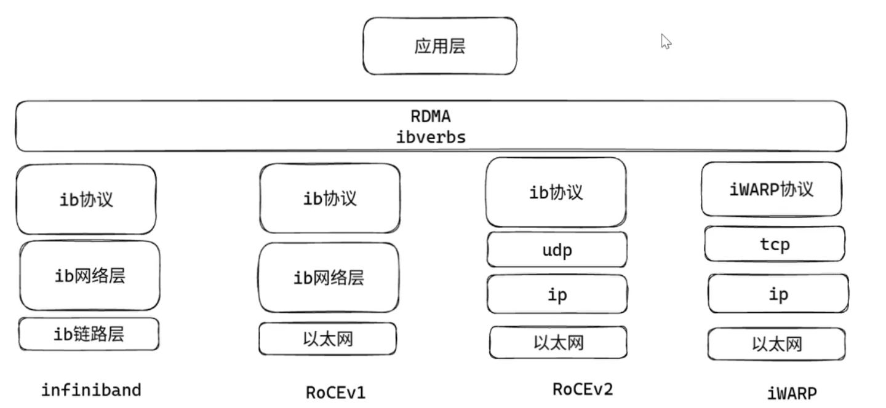
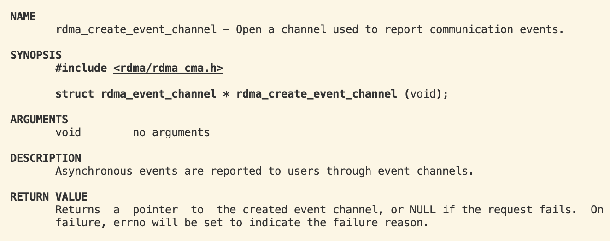
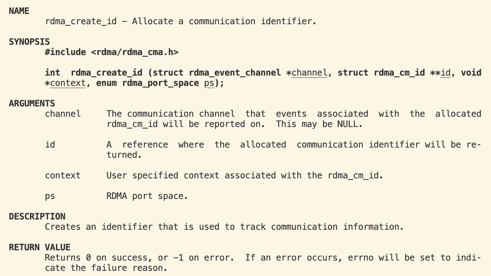
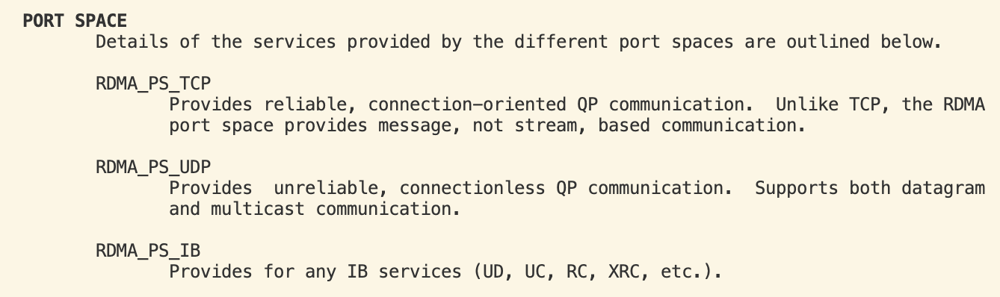
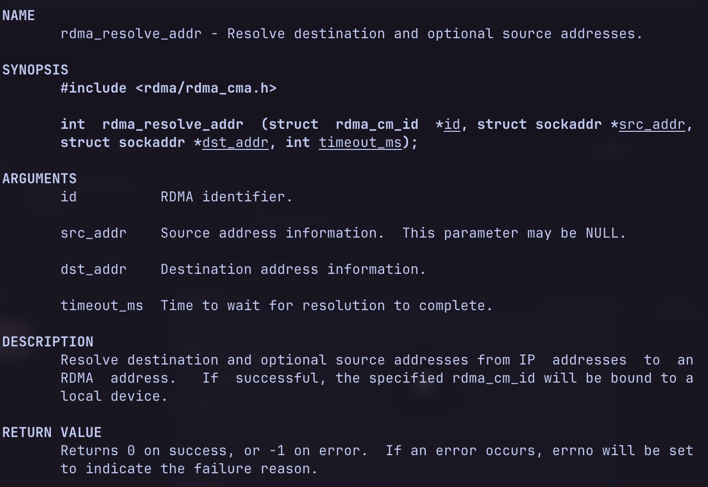
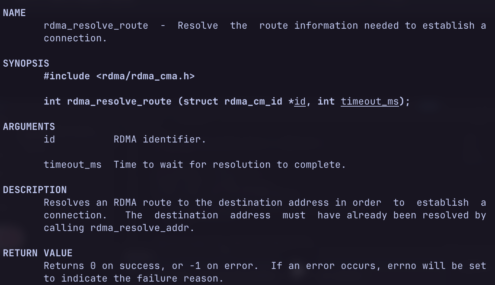
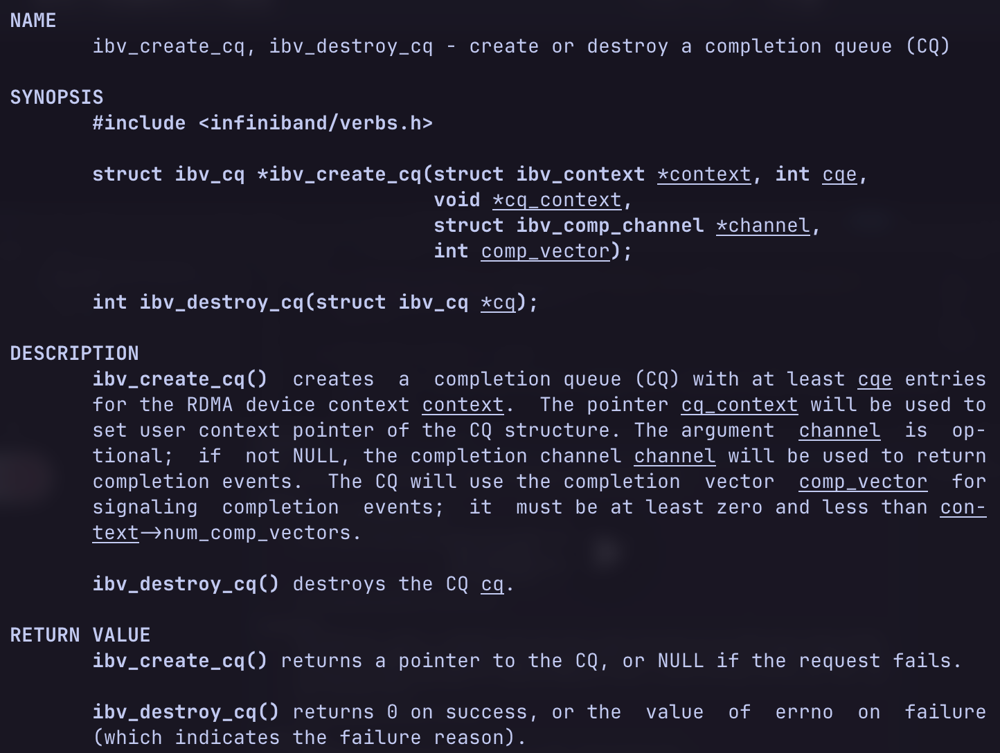
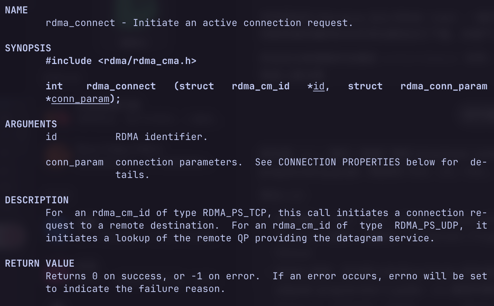
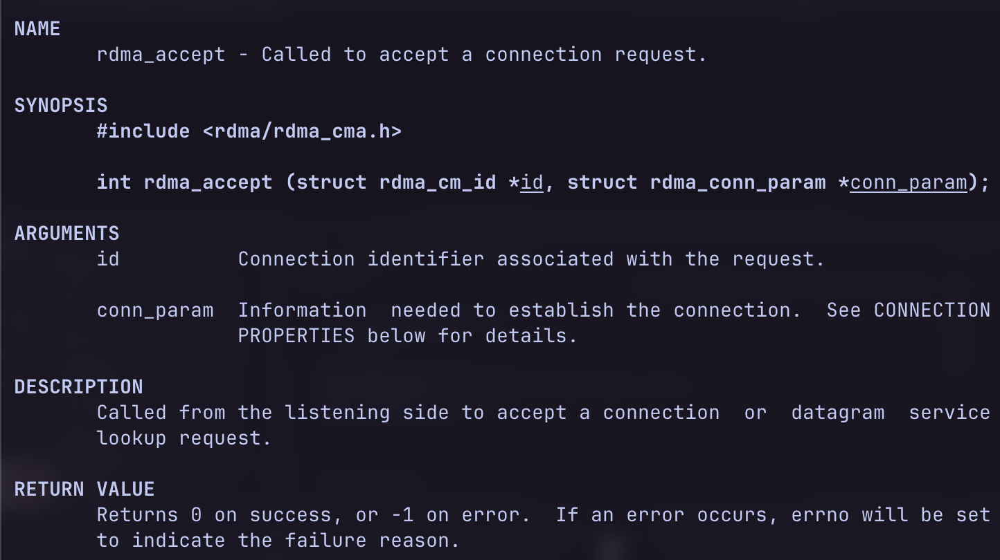

> 高性能网络 / 存储 / AI infra 里，这块绕不开。
> 本笔记先把「普通 TCP 路径」和「RDMA 旁路」掰开，再落到 **iWARP + ibverbs**，最后接到我们自己的 **91kvstore**。

---

## 1. 先看普通路径：应用 → 内核 → 网卡

平时应用层收发数据，大致是：

```text
应用  ──POSIX API──►  TCP/IP 协议栈  ──►  网卡驱动  ──►  网卡硬件
```

- TCP/IP + driver 都在 **OS 内核**里
- Redis / Nginx / MySQL 都一样：包进内核，协议栈解析完，应用再用 `read`/`recv` 把数据拿走

也就是说：**每次收发都要进一趟内核协议栈。**

---

## 2. RDMA 想干嘛：内核旁路

RDMA 不是某一家私有黑科技，而是一类方案的统称。

核心直觉：

> 应用发数据时，尽量 **旁路内核协议栈**，让网卡直接参与远端内存访问。



应用要做远端内存读写时，**不直接硬刚网卡寄存器**，而是调统一接口：**RDMA / ibverbs**。  
接口下面再分四条实现路径：

| 路径 | 一句话 |
| --- | --- |
| **InfiniBand** | 传输到链路全是 IB 自己的；通常要专用 IB 网卡 + 交换机 |
| **RoCEv1** | 上面还是 ib 协议 / ib 网络层，底下换成以太网链路；能跑以太，但网络层还不是 IP |
| **RoCEv2** | 只保留 ib 协议语义，下面改成 UDP/IP/以太网；和现有 IP 机房最合拍，也最常见 |
| **iWARP** | 不用 ib 协议，用 iWARP 叠在 TCP/IP/以太网上；能 RDMA，生态比 RoCE/IB 小 |

可以记成：

- **ibverbs** = 方向盘（统一 API）
- **IB / RoCE / iWARP** = 不同的路
- 图里的「ib 协议」= InfiniBand 传输那一层；RoCE 借用了它，iWARP 没有

再土一点说：很多协议处理被「沉」进网卡，应用侧更像直接跟网卡能力对话。  
RoCEv1 / IB 往往更吃专用网卡；没有硬 RDMA 卡时，常见退路是 **RoCEv2 / iWARP**（或软件模拟）。

> 本次笔记主线：**用 iWARP 把 RDMA 文件传输跑通**。  
> 眼前这套 API，观感很像 POSIX——**ibverbs 把 RDMA 能力抽象出来了。**

---

## 3. 建连：事件通道、id、地址、路由



事件通道（event channel）= **异步事件通知**入口。CM（连接管理）上发生的事，从这儿冒出来。



`rdma_create_id` 有点像 `socket()`：先拿一个 **id**，用来追踪这次通信。  
参数里常见：channel、id、context（我们常常不管）、以及地址族/类型（TCP / UDP / IB 等）。



图里 IB services 那路，更贴 RoCEv1 / 真 InfiniBand——往往要物理能力支撑。



把 IP 地址解析成 RDMA 能认的地址；成功后再绑到本机 device 上。



再解析路由，真正去 **创建连接**。

---

## 4. 三个关键对象：PD、QP、CQ

### PD（Protection Domain，保护域）

传输时要碰内存。PD 可以想成 **寄快递的盒子**：这块内存归谁管、别的 QP 能不能乱碰，先划界。

### QP（Queue Pair，队列对）

两端要能互相通信，就要各有一对队列：

- **SQ**（Send Queue）：我要发出去的请求挂这里
- **RQ**（Recv Queue）：我准备好收的缓冲挂这里



客户端 / Server 各建 QP，中间用 WR（Work Request）描述「发什么 / 收什么」。  
PD 管住这些操作能碰到的内存范围。

### CQ（Completion Queue，完成队列）



请求丢进 SQ/RQ 后，**完没完**看 CQ：网卡干完活，往 CQ 里塞 WC（Work Completion）。

---

## 5. RDMA 和 TCP 啥关系？（我们用的是 iWARP）

我们现在走的是 **iWARP，底下仍基于 TCP**。

传输文件时，有人会问：RDMA 对 TCP，是不是像 HTTP 对 TCP？  
不完全是同一个比喻——HTTP 是应用协议；RDMA/iWARP 更像「另一种收发与内存访问模型」，只是 iWARP 选择骑在 TCP/IP 上。



listen 侧等到连接事件，再 accept，才能拿到一条可用连接。

---

## 6. Server 侧建连：和 TCP 对照着记

**RDMA（rdma_cm）大致顺序：**

1. `rdma_create_event_channel()` — 事件通道  
2. `rdma_create_id()` — 通信 id  
3. `rdma_bind_addr()` — 绑本机地址  
4. `rdma_listen()`  
5. `rdma_wait_cm_event()` — **常阻塞在这儿等连接**  
6. `rdma_accept()` → 再 `rdma_wait_cm_event()` 等到建立完成  

**TCP 对照：**

```text
socket() → bind() → listen() → accept()  ← 常阻塞在 accept
```

味道很像，只是 RDMA 把「有事件了」拆到 CM 事件通道上，而不是一个 `accept` 包办所有语义。

---

## 7. 数据面：SQ / RQ、MR、WR / WC

### 队列怎么转

RDMA 工作时，两端各自有 SQ / RQ。  
你在本机把请求丢进队列；对端对应队列配合——**两台机器，却像在操作一对映射好的通道**。

发送侧常见心智模型：

> App 把活放到 SQ 里，后面收发细节更多交给 RDMA 机制 / 网卡；  
> 你要做的是：缓冲合法、请求填对、完成要去 CQ 里收。

### MR（Memory Region）

**MR = Memory Region**：把一块用户内存 **注册给网卡**，网卡才有权限 DMA 直接碰它。

- 发送 / 接收缓冲区，都应该落在已注册的 MR 里，而不是随便一块普通堆内存就当能 DMA
- 注册常用 ibverbs 的 `ibv_reg_mr`（对已 `calloc` / 准备好的内存）
- **lkey**：本地密钥，本机 `ibv_post_send` / `ibv_post_recv` 时要带，网卡才认这块缓冲
- **rkey**：给对端做 **RDMA READ / WRITE** 用的（对端伸手掏你内存时需要）

理想映射关系可以想成：本机 rbuffer ↔ 对端 sbuffer（方向对称理解即可）。

### 三个队列 + 两种「单据」

| 名字 | 角色 |
| --- | --- |
| SQ | Send Queue |
| RQ | Recv Queue |
| CQ | Completion Queue |
| WR | Work Request，丢进 SQ/RQ |
| WC | Work Completion，从 CQ 取出 |

### `ibv_post_send` / `ibv_post_recv`

实践里常对 `ibv_post_send` 做一层薄封装，少填一遍样板字段。

- **`ibv_post_send`**：把一条（或一串）SEND / WRITE / READ 的 WR 丢进 QP 发送队列，让网卡去干；函数 **立刻返回**。真发完了没有，靠后面 **poll CQ 等 WC**。
- 想提升吞吐时，一条 `ibv_post_send` 可以挂多个 **SGE**（分散聚集）。
- **`ibv_post_recv`**：对称，把接收缓冲预先挂到 RQ。
- 结果：**WC 在 CQ 里拿。**

---

## 8. 接到 91kvstore：我们怎么用

上面那些 channel / id / PD / QP / MR / `post_send` / poll CQ，在仓库里 **不是散落调用**，而是收进了 `rdma_transport`。  
复制状态机仍在 `replication.c`：它只拿不透明的 connection 指针，**不直接碰 ibverbs 资源**。

相关提交可以记两笔：

- `7bdaaca`：全量同步统一走 RDMA，拆掉旧 TCP 快照路径；Primary 必须配 `rdma_port`；全量结束后用边界 **O** 接 TCP 的 AOF 追赶
- `810fa0e`：加固失败路径（半截断连、端口冲突、错误端口、主动建连超时）；修掉 NtyCo hook 截获 librdmacm 的坑

### 8.1 我们实际选的路：Soft-iWARP（siw）

笔记主线是 iWARP。开发机没有真 RDMA 网卡，于是用内核 **Soft-iWARP（`siw0`）** 把 ibverbs / rdma_cm 跑通。

**这只能证明功能对，不能拿去吹性能。** README 也如实这么写。

数据面当前是 **SEND / RECV**，不是 RDMA WRITE/READ（「拿着 rkey 去掏对端内存」）。  
更像：双方约好 **一块一块扔信封**；不是单边伸手翻对端抽屉。

### 8.2 两张网要分清

主从先有一条普通 **TCP（RESP）** 控信：

```text
Replica PING → Primary PONG → Replica PSYNC
  → Primary 回 FULLRESYNC_RDMA（同步 ID、边界 O、RDMA 端口…「工牌」）
```

大文件快照 **不再走这条 TCP**。  
Primary 另开 `rdma_port` 听 RDMA；Replica 按工牌去连。  
全量期间若有人想从 TCP 塞快照，直接拒——避免「测绿了，其实快照还在 TCP 里混过去」。

| 平面 | 负责什么 |
| --- | --- |
| TCP | 握手、状态、后来的 AOF 增量、`ONLINE` |
| RDMA | 只搬二进制快照（按块） |

### 8.3 建连（还是 rdma_cm 那套味）

**Primary：**  
`rdma_create_event_channel` → `rdma_create_id` → bind → listen → 等 `CONNECT_REQUEST` → accept → 等到 `ESTABLISHED`

**Replica（主动连）：**  
解析地址 / 路由 → connect → 等到 `ESTABLISHED`  
主动建连有 **整体超时**（约 3 秒量级：含解析 + 等到 ESTABLISHED）；超时即失败，不干等。

连接对象里备齐：CM id、PD、CQ、QP、MR、注册缓冲。  
上层复制模块不自己 `reg_mr`，只说：「发这块 / 收一块 / 断一下」。

### 8.4 泵：一块 SEND，一块 ACK

```text
读快照块（snapshot_io）
  → 拷进已注册 send buffer
  → ibv_post_send
  → 对端 ibv_post_recv 收到后写入临时文件
  → 回累计 ACK（已可靠收到多少字节）
  → 对得上才发下一块
```

记住三句：

1. CQ 里的 **SEND 完成 ≠ 对端已经装进库**  
2. 要等整份快照写完 + 安装成功后的累计确认  
3. 当前每方向基本只挂一个未完成请求——简单优先，吞吐不是第一目标  

另外：文件 → 临时块 → 注册缓冲 → 网卡，这一趟 **并不是端到端零拷贝**；零拷贝是以后的优化故事。

### 8.5 正常挂断 vs 意外掉线（面试高频）

| 情况 | 之后怎样 |
| --- | --- |
| **预期挂断** | 泵完且 ACK 齐 → Primary **主动** disconnect → CM 报 DISCONNECTED → 进 CATCH_UP → TCP 从 O 追 AOF → `ONLINE` |
| **意外掉线** | TCP 断 / RDMA 意外掉 / 端口不对 / 对端不是 RDMA → 拆连接与临时文件 → **DISCONNECTED** |

**没有自动重连，也没有断点续传。** 要再来：重启 Replica，重新 `PSYNC` 走全量。  
这些口子在 `810fa0e` 里补齐，双机回归也按这个语义验过。

### 8.6 脏但真实的坑：NtyCo 的 write hook

协程库会 hook 一批 libc 读写。  
librdmacm 建连时自己也要碰 **设备 fd**；若被当成普通 socket「等就绪」，设备 I/O 会怪。  

链接加上：`-Wl,--exclude-libs,libntyco.a`  
→ 自己的协程 hook 还在，但别让动态链接的 librdmacm 误用那套 hook。  
这种坑课本不写，提交记录里才有。

### 8.7 和开头那句怎么对上（面试口述）

「眼前是类似 POSIX 的 ibverbs」——对，数据面最终还是 `post_send` / `post_recv` / poll CQ。  
工程上前面还垫了 **rdma_cm 连接生命周期**，后面还垫了 **复制状态机 + 自己的块/ACK 协议**。

别只说「调了几个 `ibv_xxx`」。更准的一句：

> 控信用 TCP；全量快照用 rdma_cm 建连 + ibverbs SEND/RECV 分块；Soft-iWARP 验证功能；失败回 DISCONNECTED 重来；增量追赶仍走 TCP；eBPF 是下一阶段。

---

## 以后还可以补

- WR / SGE 在我们薄封装里怎么填  
- 换成真正 RoCE 网卡时，路径上要动什么、什么可以不动  
